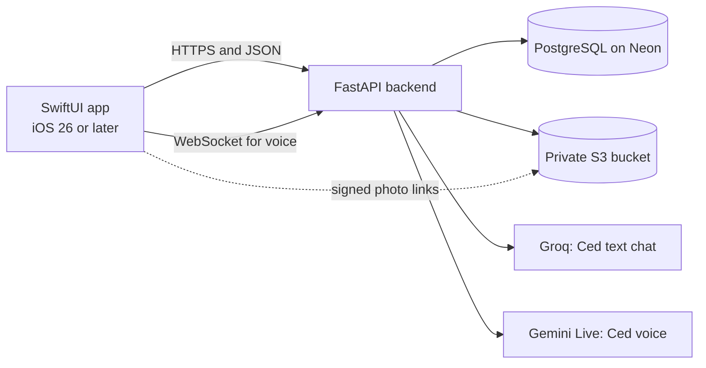

<div align="center">


# Ctrl + Ex + Delete

### Reflect. Rebuild. Reconnect.

An iOS app that helps people take small, kind steps after a breakup: a daily check-in, a few well-matched activities, a scrapbook of what they notice, and **Ced**, an AI companion for the hard moments.

[Features](#features) · [Demo](#demo) · [Architecture](#architecture) · [Privacy and safety](#privacy-and-safety) · [Getting started](#getting-started) · [Documentation](#documentation) · [Team](#team)

</div>

CED is a Fall 2026 senior capstone project at the University of North Carolina at Greensboro. Instead of counting days since the breakup, it asks people to do small things, notice how they feel afterwards, and watch their own progress build up in a pixel-art Healing Room. There are no accounts or sign-ins.

## Features

- **Daily check-in.** Four short questions: how you feel, how strong the urge to contact your ex is, your energy, and what feels hardest.
- **Healing Room.** The pixel-art home screen. Ced's message for the day answers your check-in; tap Ced for today's activity, the scrapbook for your story, the telephone for support, or the big plant for a kindness game. A bookshelf gains one book for every completed activity.
- **Activities.** Up to three cards a day from a catalog of 100 activities in four categories (outdoor and movement, mindfulness and rest, solo exploration, social connection). Explicit rules choose them from your energy, feeling, hardest areas and urge, so the same answers always give the same cards. One activity is in progress at a time; you can save one for later or change your mind.
- **Reflection and Story.** Finishing an activity means adding a photo, a short note and two quick questions. Each one becomes a memory in your Story, grouped by month.
- **Progress.** Week and month views of your urge and how you felt after activities, what you made time for, and a few gentle observations. They describe what you reported and never claim that something caused a change.
- **Support with Ced.** Talk by text or on a voice call, or use *Say it here first* to write the message you want to send your ex and talk it through instead. Crisis resources appear in the conversation and open only when you tap them.
- **Grow with Kindness.** A small plant game: read three affirmations aloud and Apple's speech recognition (on-device when your iPhone supports it) highlights the words as you go.
- **Moving forward.** When you feel ready, five reflection questions lead to a farewell gift: a keepsake PDF scrapbook of your whole journey, made on your phone.

## Demo

**Demo video:** [Ctrl+Ex+Delete Walkthrough Video](https://www.youtube.com/watch?v=-tWLe--WAB0)


The high-fidelity design prototype is in [Figma](https://www.figma.com/make/duI7iQsbRaVqy7C29hRtjn/C-E-D-High-Fidelity-Prototype?code-node-id=0-6&p=f&t=UUIneb7l82DPCyL4-0&fullscreen=1).

## Architecture



- **App:** SwiftUI with Observation; the Healing Room is drawn with `Canvas`.
- **Backend:** FastAPI with one module for all SQL and one for all S3 access. The recommendation, insights and room-message rules are plain, tested functions.
- **Data:** PostgreSQL enforces the product rules (one check-in a day, one activity in progress, rows tied to their own installation). Photos go straight to a private bucket through short-lived signed links.
- **Ced:** the backend relays chat to Groq and voice to Gemini Live, so no provider key reaches the phone.

More detail, with the key flows and design decisions, is in [`docs/architecture.md`](docs/architecture.md).

## Technology

| Area | Technology |
|---|---|
| App | Swift, SwiftUI, Observation; iOS 26 or later, built with Xcode 26 |
| Backend | Python 3.11, FastAPI, psycopg 3 |
| Database | PostgreSQL (Neon) |
| Photo storage | AWS S3 with presigned URLs |
| Ced | Groq for text chat and risk checks, Gemini Live for voice |
| Hosting | Render |
| Design | Figma, Lora and Nunito typefaces, pixel art |
| Testing | pytest for the backend, Swift logic tests that run on a Mac |

## Privacy and safety

- **Account-free, ID-based.** There is no sign-up. The app creates a random installation ID, keeps it in the iOS Keychain and sends it with every request; that ID is the only thing that ties data to a phone. CED never asks for a name, email address or phone number.
- **What is stored.** Check-in answers, activity progress, reflection notes and photos are saved on the backend (database and private bucket) under that installation ID. Notes and photos are personal content, and there are no passwords: anyone who obtained an installation ID could request its data.
- **Conversations with Ced.** The backend is built not to store chat or call text or write it to its logs; it keeps only a daily message count for rate limits, and the app discards a conversation when it ends. To answer, the text and call audio are sent to the AI providers (Groq and Google), whose own terms and settings govern what they retain. Ced's summary of your journey covers check-in answers and activities, not your notes or photos.
- **Photos.** They live in a private bucket and are reached only through links that expire.
- **Safety layers.** Ced's replies combine written rules, the model's own rating and a check of every reply, with fixed fallback messages if the provider is unavailable. Crisis resources (988, or 911 in danger) appear in context and open only when you tap them. These checks reduce risk but cannot catch everything.
- **Keys stay on the server.** The app contains no AI, database or storage keys.

Ced is an AI companion for reflection, not a therapist, and it does not give diagnoses or treatment. Neither Ced nor the affirmation game has been clinically validated for breakup recovery.

## Getting started

You need a Mac with **Xcode 26 or later**. To run your own backend you also need **Python 3.11 or later** and a local **PostgreSQL**.

**Run the app.** Open `CtrlExDelete/CtrlExDelete.xcodeproj`, choose an iPhone simulator and press Run. By default the app uses the project's deployed backend. To run on a physical iPhone, copy `CtrlExDelete/Config/DeveloperSettings.example.xcconfig` to `DeveloperSettings.xcconfig` (it is git-ignored) and set your own team and bundle ID there.

**Run your own backend.**

```bash
cd backend
python3 -m venv venv && source venv/bin/activate
pip install -r requirements-dev.txt
createdb ced_dev              # a local PostgreSQL database
cp .env.example .env          # then set DATABASE_URL=postgresql://localhost/ced_dev
python -m scripts.migrate     # creates the schema and loads the catalogs
uvicorn app.main:app --reload
```

Then add `CED_BACKEND = local` to your `DeveloperSettings.xcconfig` and run the app once from Xcode. The AI features need `GROQ_API_KEY` (chat) and `GEMINI_API_KEY` (voice) in your settings file; without them the rest of the app works. Every setting is listed with a placeholder in [`backend/.env.example`](backend/.env.example); bucket setup is in [`docs/DATABASE_DESIGN.md`](docs/DATABASE_DESIGN.md) and `render.yaml` records the hosted service's settings.

**Run the tests.** The backend tests change shared data, so they run only against a local database (see "Running the tests" in [`backend/README.md`](backend/README.md)):

```bash
cd backend && CED_ENV_FILE=.env.test pytest -q
cd CtrlExDelete && ./DevTests/run.sh      # Swift logic tests, no simulator needed
```

## Documentation

| Document | What it covers |
|---|---|
| [`docs/architecture.md`](docs/architecture.md) | System design, key flows, Ced's safety layers and design decisions |
| [`docs/api.md`](docs/api.md) | The contract between the app and the backend |
| [`docs/DATABASE_DESIGN.md`](docs/DATABASE_DESIGN.md) | The database schema and photo storage |
| [`docs/affirmations.md`](docs/affirmations.md) | The Grow with Kindness catalog and its research sources |
| [`backend/README.md`](backend/README.md) | Backend setup, settings, migrations and tests |
| [`THIRD_PARTY_NOTICES.md`](THIRD_PARTY_NOTICES.md) | Licenses for the icons and fonts the app includes |

## Team

CED was developed by a four-person team. Each member focused on different parts of the application.

| | Responsibilities |
|---|---|
| **Ayusha Thapa** | Designed and developed the SwiftUI frontend, including the app's UI/UX, pixel-art Healing Room, and Grow with Kindness plant game. |
| **Sangye Tengkhar** | Developed and integrated CED's AI features, including text chat, voice calls, safety mechanisms, and crisis detection. Also managed backend integration, hosting, and deployment. |
| **Alexa Chegue-Santos** | Developed the FastAPI backend and activity recommendation system, including API endpoints and logic for recommending activities based on users' daily check-ins. |
| **Leonard Parra** | Responsible for the initial database and cloud storage setup using Neon PostgreSQL and AWS S3, supporting persistent user data and photo uploads. |
