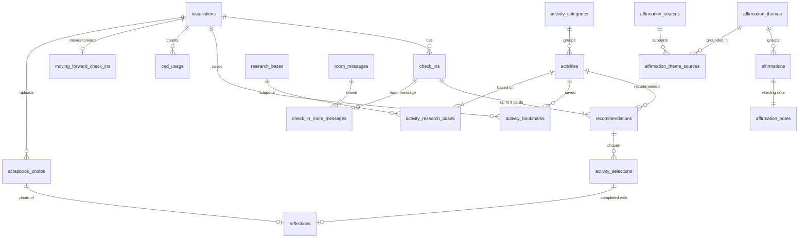

# Database and photo storage

CED stores its data in PostgreSQL (hosted on Neon) and its scrapbook photos in a private S3 bucket. The schema is one baseline migration, [`backend/db/migrations/001_schema.sql`](../backend/db/migrations/001_schema.sql). It defines 20 tables: 10 hold user data and 10 are shared catalogs. `scripts.migrate` adds an 11th, `schema_migrations`, to record which migration files have run. For how the pieces fit together, see [`architecture.md`](architecture.md); for the API that reads and writes this data, see [`api.md`](api.md).

## Design rules

- **User data hangs off `installations`.** An installation is the app's Keychain UUID. Every user table references it with `ON DELETE CASCADE`, so deleting an installation deletes everything it owns.
- **A row can only point at rows of the same installation.** Tables that reference each other use composite foreign keys on `(id, installation_id)`. A selection cannot point at another installation's recommendation, even through a bug in application code.
- **The database enforces the product rules.**
  - One check-in per installation and local day (`UNIQUE (installation_id, local_date)`).
  - At most one activity in progress per installation (a partial unique index).
  - At most one live, not abandoned, choice per recommendation card (a partial unique index).
  - Every enumerated answer has a `CHECK` constraint: feeling, energy, hardest areas, mood and so on.
- **Answers are stored as given.** Mood answers stay text (`worse` to `much_better`); the numeric scores used to size chart bars are computed in code and never stored.
- **Memories outlive their links.** A reflection keeps its text if its activity choice or photo is removed; only the link is cleared (`ON DELETE SET NULL`). A completed activity records its own completion day, so deleting a memory never un-completes it.
- **Catalogs are retired, not deleted.** An activity with user history is marked `is_active = false` instead of being removed, so history keeps its meaning.
- **A day's room message is a snapshot.** `check_in_room_messages` stores the message text shown, so editing the catalog never rewrites a past day.
- **Ced stores no text.** `ced_usage` holds only a daily message count.

## Entity relationships



Every user table also carries `installation_id`, which the composite foreign keys use; the diagram shows only the main relationships.

## User data

| Table | Holds | Notable constraints |
|---|---|---|
| `installations` | One row per app install (the Keychain UUID) | `last_seen_at` is updated at most once a day |
| `check_ins` | A day's answers: feeling, contact urge (1 to 10), energy, hardest areas | One per installation and local day; `hardest_areas` limited to the five allowed values |
| `recommendations` | The cards chosen for a check-in, in order | Unique position and unique activity per check-in |
| `activity_selections` | An activity the user chose: `in_progress`, `completed` or `abandoned` | One in progress per installation; `ended_at` is set exactly when the status is not in progress; `completed_on` is set exactly when completed |
| `scrapbook_photos` | A photo record; the file is in S3 under a random `object_key` | `uploaded_at` stays empty until the upload is confirmed |
| `reflections` | One memory: note (up to 1,000 characters), two answers, local date | At most one per activity choice and one per photo |
| `activity_bookmarks` | "Save for later" | Primary key `(installation_id, activity_id)`, so no duplicates |
| `check_in_room_messages` | The room message shown for a check-in, with its text | One per check-in |
| `moving_forward_check_ins` | The day the user first chose "I'm ready to move forward" | One per installation; no answers stored (the API requires all five) |
| `ced_usage` | Messages sent to Ced per installation and UTC day | A count only |

## Catalogs

The catalogs are loaded by seed scripts, not by migrations, so the schema stays small and the data stays easy to review.

| Table | Holds | Source |
|---|---|---|
| `activity_categories` | The four categories (`outdoor_movement`, `mindfulness_rest`, `solo_exploration`, `social_connection`) and their display names | `scripts/catalog_data.py` |
| `activities` | 100 activities, 25 per category, with energy demand, duration, movement flag, instructions and why-it-fits text | `scripts/catalog_data.py` |
| `research_bases`, `activity_research_bases` | Six broad research approaches and the activities each one informs | `scripts/catalog_data.py` |
| `affirmations`, `affirmation_themes` | The 30 sentences of the Grow with Kindness game in five themes | `scripts/affirmation_data.py` |
| `affirmation_sources`, `affirmation_theme_sources`, `affirmation_notes` | The sources behind each theme and an editorial note for each sentence (see [`affirmations.md`](affirmations.md)) | `scripts/affirmation_data.py` |
| `room_messages` | 32 lines of Ced's room messages across eight patterns | `scripts/room_message_data.py` |

Research links describe where an idea comes from; they do not claim that a specific activity or sentence was tested.

## Indexes

Indexes support the queries the app makes: a user's recent check-ins, memories and photos, the activity completions used by Insights, and catalog retire-or-delete checks (`recommendations(activity_id)` and `activity_bookmarks(activity_id)`). The catalog tables are small enough that PostgreSQL scans them directly, so they have no extra indexes.

## Migrations and tooling

- `001_schema.sql` creates the whole schema in an empty database. The earlier migration history is kept in `backend/db/migrations/legacy/` for reference only, and `scripts.migrate` refuses a database that has that history.
- To change the schema, add a new numbered file (`002_*.sql` and on). An applied migration is never edited.
- `python -m scripts.migrate` applies unapplied files, then loads the catalogs; the load never deletes user history. `--status` shows what has run and changes nothing.
- `python -m scripts.verify_database` checks every expected table, column, constraint and index, the catalog contents and links, and, with `--fresh`, that the user tables are empty.
- `backend/tests/test_schema.py` tests the database's own rules: the note length, the allowed hardest areas, `last_seen_at` moving at most once a day, moving forward without stored answers, the migration guard, and that a database matches the schema and catalogs. Other test modules cover one check-in per day and the activity lifecycle.

## Photo storage

The photos in the scrapbook live in a private S3 bucket. The app and the bucket talk directly through short-lived signed links, so the API never handles image bytes and never exposes AWS credentials.

- **Upload:** `POST /scrapbook/photos` creates the database row with a random key (`scrapbook/<random>.jpg`) and returns a signed upload link, valid for 5 minutes. The content type (`image/jpeg`) is part of the signature.
- **Confirm:** after the upload the app calls `/complete`. The backend checks with S3 that the file exists and is at most 5 MB; a larger file is deleted.
- **View:** the API returns a fresh signed download link, valid for 1 hour, whenever it returns a memory.
- **Random keys.** The installation ID is the user's only credential, and the key is part of every link, so keys carry no identity. The database row links key and owner.
- **Delete order.** Deleting a photo or memory removes the database row first and then the file, so a failed file delete leaves an unreferenced object, never a row that points at nothing.
- **Orphans.** Photos that never become part of a memory are removed, row and file, after a day, the next time that installation starts an upload.
- **Timeouts.** Every S3 call has connect and read timeouts and a bounded retry, so a stuck call cannot hold a request open.

### Bucket setup

Use one bucket and one IAM user per environment, so a test environment can never touch another one's photos.

- **Bucket:** in the same region as the backend host. Block all public access on, Object Ownership set to bucket owner enforced (ACLs disabled), default encryption SSE-S3, versioning off (so a deleted photo is really gone), no bucket policy and no CORS rules. The app uses short-lived signed links, so nothing else is needed.
- **IAM user:** no console access, with this inline policy for its own bucket. `ListBucket` lets the backend tell a missing photo (404) from a refused one (403), and `GetBucketPublicAccessBlock` lets `scripts.check_s3` confirm the bucket is private.

```json
{
  "Version": "2012-10-17",
  "Statement": [
    { "Effect": "Allow",
      "Action": ["s3:ListBucket", "s3:GetBucketPublicAccessBlock"],
      "Resource": "arn:aws:s3:::YOUR-BUCKET" },
    { "Effect": "Allow",
      "Action": ["s3:GetObject", "s3:PutObject", "s3:DeleteObject"],
      "Resource": "arn:aws:s3:::YOUR-BUCKET/*" }
  ]
}
```

- **Access key:** create one for that user (use case "Application running outside AWS") and put it, with the region and bucket name, in the environment's settings file. Then run `CED_ENV_FILE=<file> python -m scripts.check_s3`. On a Mac with Python from python.org, `CERTIFICATE_VERIFY_FAILED` means Python has no root certificates yet: run its "Install Certificates.command", or prefix the command with `SSL_CERT_FILE=$(python -m certifi)`.
