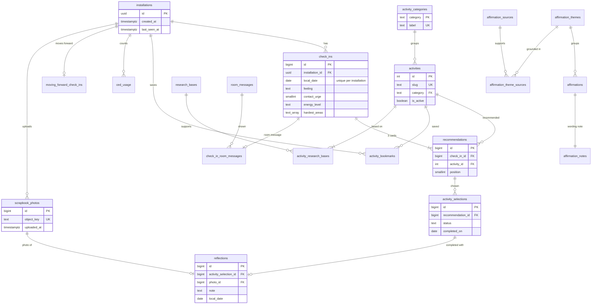

# Database and photo storage: fresh-start design (proposal)

Status: **changes A–H implemented** on `refactor/final-optimization`
(approved 2026-11-04; results in section 8). The S3 changes in section 4 are
part of the setup step. The original Neon database and S3 bucket stay
untouched as the backup; the new schema goes into new, empty resources in
your own accounts (setup: `docs/MIGRATION.md`).

## 1. What exists today

Audited from the production schema itself (restored without data from the
2026-11-04 backup), the 18 migrations, `app/storage.py`, the seed scripts and
the iOS client.

**21 tables:** 10 hold user data, 10 are shared catalogs, plus `schema_migrations`.

| Table | Purpose | Used by (API → app feature) | Keep? | Issues |
|---|---|---|---|---|
| `installations` | One row per app install (Keychain UUID) | every write path → identity | yes | `last_seen_at` is updated on every write and never read |
| `check_ins` | Daily check-in answers | `/check-ins`, `/insights`, `/progress/summary`, `/farewell-scrapbook` → check-in, Day N, Insights, Story, room | yes | `counts_for_day` plus a partial unique index only exist for duplicates made before migration 014; an extra index duplicates the unique one |
| `recommendations` | The 3 cards for a check-in | `/recommendations/latest`, `/…/selection` → Activity tab | yes | `created_at` never read |
| `activity_selections` | Chosen activity: in progress / completed / abandoned | `/activity-selections/*`, progress, bookshelf, Insights → Activity, Story, Bookshelf | yes | index includes `selected_at`, never filtered on |
| `reflections` | One memory per completed activity (note, two answers, photo) | `/reflections`, Insights, farewell → Reflection, Story, PDF | yes | DB allows a 2,002-char note, API allows 1,000 |
| `scrapbook_photos` | Photo record; the file is in S3 | `/scrapbook/photos/*` → Reflection, Story, PDF | yes | `byte_size` written, never read |
| `activity_bookmarks` | "Save for later" | `/bookmarks` → Activity | yes | no index on `activity_id` (catalog deletes scan it) |
| `ced_usage` | Daily Ced message count (no text) | chat and voice limits | yes | — |
| `moving_forward_check_ins` | "I'm ready to move forward" | `/moving-forward`, farewell → Moving Forward, Story, final gift | yes | `reflected_on` always holds all five answers (the API requires them), `created_at` never read |
| `check_in_room_messages` | The room message shown for a check-in, with its text kept | `/check-ins/today` → Healing Room | yes | — (the text snapshot is deliberate: catalog wording can change) |
| `activities` | The 100-activity catalog | recommendations, bookshelf, Insights | yes | `category_label` copies the category's name, kept in step by a trigger and a two-column foreign key |
| `activity_categories` | The 4 categories and their names | joined for labels | yes | — |
| `research_bases`, `activity_research_bases` | Research approach behind each activity (109 links) | seeds and tests only (provenance) | yes | `activity_id` is `bigint`, `activities.id` is `integer` |
| `affirmations`, `affirmation_themes` | The plant game's 30 affirmations | `/affirmations` → Grow with Kindness | yes | — |
| `affirmation_sources`, `affirmation_theme_sources`, `affirmation_notes` | Why each affirmation is worded as it is | seeds and tests only (provenance) | yes | — |
| `room_messages` | The 32 room-message lines | room message choice | yes | — |
| `schema_migrations` | Applied migration files | `scripts.migrate` | yes | — |

**History problems:** 10 of the 18 migrations change *data* (activity
inserts, a legacy-activity removal, label backfills), so a new database
replays years of catalog edits before the seeds overwrite them. Two files
share the number 008.

**What's already good and stays:** composite "same installation" foreign keys
(a selection can only point at a recommendation of the same installation);
partial unique indexes for "one activity in progress" and "one live selection
per card"; CHECK constraints for every answer; `ON DELETE CASCADE` from
`installations` for all user data; the catalogs keyed by stable text ids.

**Catalog safety check (done):** a database built only from the repo's
migrations and seed scripts matched production in all ten catalog tables:
100 activities, 109 research links, 6 research bases, 30 affirmations with 11
sources, 17 theme links and 30 notes, 32 room messages, 4 categories. Nothing
needs exporting from the old database.

## 2. Proposed changes

Each change has a concrete benefit; none changes an API response.

| # | Change | Benefit | Risk |
|---|---|---|---|
| A | **One clean baseline migration** (`001_schema.sql`) with the final schema; catalogs only from the seed scripts. The 18 old files move to `db/migrations/legacy/` (history kept). `scripts.migrate` refuses a database that has the legacy history. | A new database is created in one readable step; no replayed data edits; the old database can't be "upgraded" by accident | Low. Production keeps its old schema until cutover, then switches to the new database |
| B | `check_ins`: drop `counts_for_day`; plain `UNIQUE (installation_id, local_date)`; drop the duplicate index | One check-in per day is a real constraint again; simpler queries and `ON CONFLICT` | Low |
| C | `activities`: drop `category_label`, its trigger, function and two-column foreign key; `category` references `activity_categories(category)`; queries join the label | No copied data or trigger to keep in step | Medium: about 8 queries gain a join (tests cover them) |
| D | Ids: `GENERATED BY DEFAULT AS IDENTITY` instead of `serial`; activity ids `integer` everywhere | One id style; the research link matches the column it points at | Low |
| E | Drop never-read columns: `scrapbook_photos.byte_size`, `recommendations.created_at`, `moving_forward_check_ins.reflected_on` and `.created_at` (the API keeps returning the five answers) | Less to write and keep consistent | Low |
| F | Constraints match the API: note ≤ 1,000 characters; at most 5 hardest areas | The database refuses what the API refuses | Low |
| G | Indexes: add `recommendations(activity_id)`, `activity_bookmarks(activity_id)`; trim `activity_selections` index to `(installation_id)`; drop the three indexes on 30–100-row catalog tables | Catalog deletes don't scan user tables; fewer indexes that are never used | Low |
| H | `installations.last_seen_at` updated at most once a day | One less write on most requests; still usable to clear out inactive installs later | Low |

**Considered and not proposed:** merging `affirmation_notes` into
`affirmations` or `check_in_room_messages` into `check_ins` (fewer tables,
no real gain); PostgreSQL ENUM types (TEXT + CHECK changes more easily);
per-user S3 key prefixes (see section 4); renaming tables (cosmetic).

## 3. New schema

Before → after: 21 → 21 tables; 6 columns removed (`check_ins.counts_for_day`,
`activities.category_label`, `scrapbook_photos.byte_size`,
`recommendations.created_at`, `moving_forward_check_ins.reflected_on` and
`.created_at`); 1 trigger and its function removed; 13 → 10 indexes besides
keys and unique constraints (5 dropped, 2 added; the one-per-day rule becomes
a plain `UNIQUE` constraint).



(Every user table also carries `installation_id`, used by the composite
"same installation" foreign keys; the diagram shows only the main columns.)

## 4. Photo storage (S3)

The current design is sound and stays: a private bucket, short-lived
presigned links (upload 5 minutes, view 1 hour), the content type signed into
the upload link, the size checked with S3 after upload (over 5 MB is
deleted), unconfirmed or unattached photos cleared after a day, timeouts on
every S3 call.

Changes:
1. **Separate buckets and IAM users for staging and production**, each user
   limited to its own bucket (Get/Put/DeleteObject on objects, ListBucket on
   the bucket).
2. **Bucket settings:** region `us-east-1` (next to Render and the new Neon),
   Block all public access on, Object Ownership "bucket owner enforced",
   default encryption SSE-S3, versioning off (so a deleted photo is really gone).
3. **Delete order fixed:** `DELETE /scrapbook/photos/{id}` deletes the file
   before the database row; it should delete the row first (a failed file
   delete then leaves only an unreferenced object, never a row pointing at
   nothing), like reflections already do.
4. **Keys stay random** (`scrapbook/<random>.jpg`). Adding the installation
   to the key would help nothing the database doesn't already do, and the
   installation ID is the user's only credential: it must not appear in
   photo links.

## 5. Fresh initialization and verification

```bash
python -m scripts.migrate          # creates the schema, then seeds the three catalogs
python -m scripts.verify_database  # new: schema, catalog counts and links, empty user tables
```

`verify_database` checks every expected table, column, constraint and index;
100 active activities, each with at least one research base and a known
category; 109 research links; 30 affirmations, each with a theme and a note;
32 room messages covering every pattern; and that user tables are empty on a
fresh database.

## 6. Staging on Render

A second Free web service (for example `ctrl-ex-delete-api-staging`) from
`refactor/final-optimization` with auto-deploy off, set up in the dashboard
(not in `render.yaml`, so the live service's Blueprint is never touched):

| Variable | Value |
|---|---|
| `PYTHON_VERSION` | `3.11` |
| `DATABASE_URL` | the new Neon project's staging database (pooled) |
| `AWS_ACCESS_KEY_ID`, `AWS_SECRET_ACCESS_KEY` | the staging IAM user |
| `AWS_REGION`, `S3_BUCKET` | `us-east-1`, the staging bucket |
| `GROQ_API_KEY`, `GROQ_MODEL` | a separate Groq key; `openai/gpt-oss-120b` |
| `GEMINI_API_KEY` | a separate key (paid tier, logging off) |

The app reaches staging with the Debug launch argument `-CEDAPIBaseURL`.

## 7. Risks and what needs approval (as proposed)

- **Approval needed:** the schema changes A–H (one implementation pass on this
  branch, tested against a local database and a new Neon database).
- The `rehearsal` database in your new Neon project holds a copy of old user
  data from the rehearsal; with the fresh start it should be deleted (your
  call; it can't be undone). The local dumps in `.local-backup/` too, once the
  new setup is live.
- Old test builds of the app keep working against either backend: no API
  response changes.
- Cutover means users start fresh (new database): existing progress on the
  old service won't carry over, by your decision.

## 8. Results of the implementation

Tested from scratch on empty local PostgreSQL 18 databases:

- **Fresh initialization:** `scripts.migrate` applies `001_schema.sql` and
  seeds the catalogs; `scripts.verify_database --fresh` passes: 21 tables, no
  triggers, 23 validated foreign keys, the key indexes, and every catalog row
  as in the repo's data files (4 categories, 100 activities with their 109
  research links, 6 research bases, 5 themes, 30 affirmations with their
  notes, 11 sources, 17 theme links, 32 room messages covering every pattern),
  with empty user tables. The original database fails it and `migrate`
  refuses it.
- **Tests:** 294 passed, including new tests for the database's own rules
  (one check-in per day, 1,000-character notes, hardest-area limits,
  last_seen_at at most daily, moving forward without stored answers, the
  migrate guard).
- **API compatibility:** the same 40-call walkthrough of every endpoint the
  app uses gave identical responses on the old and new schemas (ids,
  timestamps and photo links normalized), and the OpenAPI schema is
  byte-for-byte the same. No iOS change is needed.
- **`last_seen_at`:** only ever written (never read by the app, scripts or
  tests), so day precision changes no behaviour.
- **Dropped indexes** (60,000 synthetic check-ins, medians of 400 runs):

  | Query | Old schema | New schema |
  |---|---|---|
  | Check-in for a day | index scan, 0.063 ms | index scan on the unique constraint, 0.043 ms |
  | A user's check-ins, newest first | bitmap scan, 0.065 ms | bitmap scan, 0.063 ms |
  | First check-in (journey start) | index-only scan, 0.043 ms | index-only scan, 0.039 ms |
  | Active activities in order | sequential scan, 0.189 ms | sequential scan, 0.153 ms |
  | Room messages for a pattern | sequential scan, 0.045 ms | sequential scan, 0.046 ms |
  | Active affirmations | sequential scan, 0.058 ms | sequential scan, 0.057 ms |

  The catalog indexes were never used (PostgreSQL scans tables of 30–100
  rows directly), and each check-in insert now maintains one index fewer.
