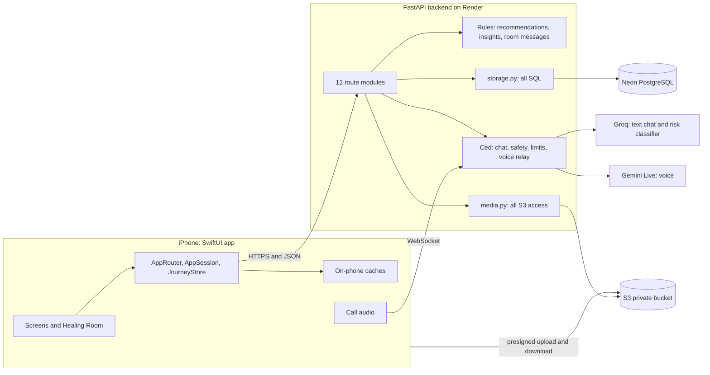
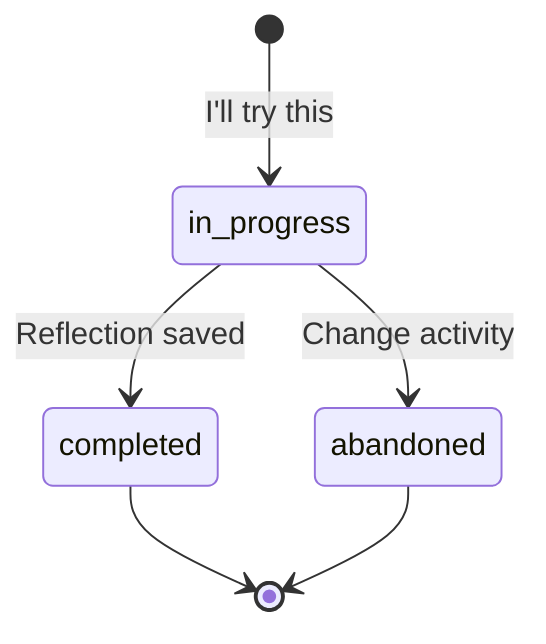
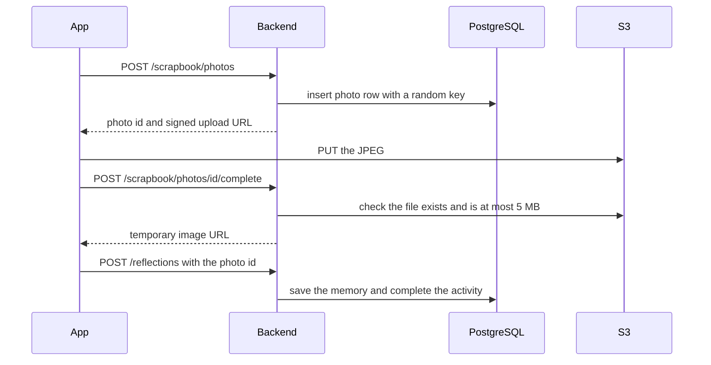
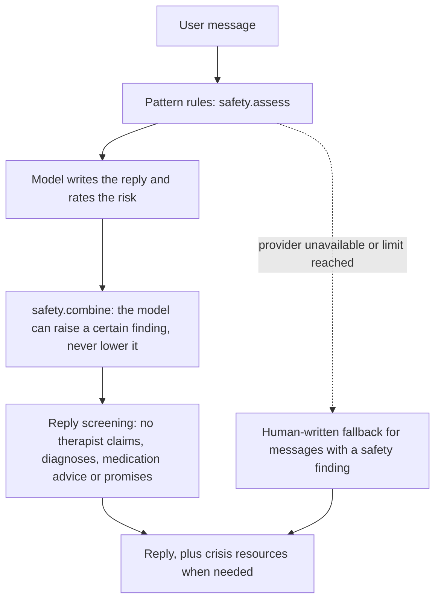

# Architecture

Ctrl + Ex + Delete (CED) is an iOS app for breakup recovery. A SwiftUI app talks to a FastAPI backend that stores data in PostgreSQL and photos in a private S3 bucket, and relays conversations with Ced, the app's AI companion, to Groq (text) and Gemini Live (voice).

This document describes the system as implemented. Related documents:

- [`api.md`](api.md): the exact contract between the app and the backend.
- [`DATABASE_DESIGN.md`](DATABASE_DESIGN.md): the database schema and photo storage.
- [`affirmations.md`](affirmations.md): the research behind the Grow with Kindness game.
- [`../backend/README.md`](../backend/README.md): backend setup, settings, migrations and tests.

## Design principles

- **Anonymous by design.** There are no accounts. Each install generates a random UUID, keeps it in the Keychain and sends it with every request. Nothing identifies a person.
- **Ced stores nothing.** Chat and voice text exist in memory while a request or call is running. Only a daily message count is kept, for rate limits.
- **Safety does not rely on the model.** Crisis detection combines written rules, the model's own rating and screening of every reply, with human-written fallbacks.
- **Deterministic recommendations.** Activity cards come from explicit, tested rules, not from a model, so the same check-in always gives the same cards.
- **The database enforces the rules.** One check-in per day, one activity in progress at a time and "a row may only point at rows of the same installation" are constraints, not application code.

## System overview



| Component | Technology | Responsibility |
|---|---|---|
| App | SwiftUI, Observation, iOS 26 or later | Screens, the Healing Room, local caches, call audio |
| Backend | FastAPI, Python 3.11, psycopg 3 | The API, rules, safety and the voice relay |
| Database | Neon PostgreSQL | All user data and the shared catalogs |
| Photo storage | AWS S3 (private) | Scrapbook photos, reached only through short-lived signed links |
| Ced text | Groq | Chat replies and an independent risk rating of voice transcripts |
| Ced voice | Gemini Live | Spoken conversations, relayed by the backend |
| Hosting | Render web service | Runs the backend, deployed manually from `main` |

## iOS app

The app lives in `CtrlExDelete/CtrlExDelete/`:

| Folder | Contents |
|---|---|
| `Theme/`, `Components/` | Palette and fonts (Lora, Nunito), shared views and controls |
| `Navigation/` | `AppRouter` and the bottom tab bar |
| `Screens/` | One view per screen; `Room/`, `Talk/` and `KindnessGarden/` for the larger areas |
| `Models/` | Stores, view models, caches, the scrapbook PDF and the pure logic behind Insights text and room dialogue |
| `Networking/` | `APIClient`, `APIConfig`, `APIModels`, `InstallationID` |
| `Voice/` | Call audio, call state and the WebSocket transport |

**Navigation.** `AppRouter` holds the current `AppScreen` (12 cases: launch, welcome, check-in, room, activities, reflection, talk, scrapbook, progress, moving forward, final gift and the plant game). `ContentView` shows that screen and the tab bar where a screen uses it. There is no navigation stack.

**State.** Three `@Observable` objects are created once in `ContentView` and passed through the SwiftUI environment:

- `AppRouter`: which screen is showing.
- `AppSession`: restores the session at launch and when the app returns on a new day. The backend decides the start screen (room, check-in or welcome); a failed request is shown as a connection message and never counts as "has not checked in".
- `JourneyStore`: the activity in progress, memories, progress summary and Ced's room message, loaded from the API and mirrored into local caches.

**Networking.** `APIClient` sends JSON with snake_case keys and the `X-Installation-ID` header. `InstallationID` creates the UUID once and keeps it in the Keychain (available after first unlock, this device only). Every build uses the deployed backend; Debug builds can opt into a local server through a git-ignored settings file.

**On-phone data.** The journey cache, the room message and the farewell PDF are written with file protection. Downloaded memory photos and the affirmation catalog are cached so the app opens quickly and the plant game works offline. When the server reports that this installation's record is new or gone, the app discards its cached journey and starts at day 1; the installation ID is kept.

**Healing Room.** The room is pixel art drawn with SwiftUI `Canvas` on a fixed 390 by 700 grid that is scaled to the screen. Its bookshelf shows one book per completed activity (capacity 32).

**Voice calls.** `CallAudio` captures the microphone with `AVAudioEngine` and echo cancellation and plays Ced's audio; `LiveVoiceTransport` carries both over a WebSocket; `CallSession` tracks the call state. A mock transport is available in Debug builds.

**Tests.** Pure logic (Insights wording, room dialogue, story text, cache reset) is tested on a Mac without a simulator: `CtrlExDelete/DevTests/run.sh`.

## Backend

```
backend/app/
├── main.py                   app, routers, database-unavailable handler, content-logger limits
├── config.py                 settings (pydantic-settings), one settings file per environment
├── dependencies.py           the X-Installation-ID header
├── schemas.py                request and response models
├── storage.py                the only module that runs SQL
├── media.py                  the only module that talks to S3
├── recommendation_rules.py   which activities to suggest after a check-in
├── insights.py               the Progress screen's calculations
├── room_messages.py          which of Ced's room messages fits a check-in
├── routes/                   12 route modules: 27 HTTP routes and one WebSocket
└── ced/                      chat, prompt, safety, risk, context, limits, bubbles, providers, voice
```

Routes validate input and call `storage`, `media` or the rule modules. The rule modules are pure functions of their inputs, which keeps them easy to test. `storage.py` is the single place that knows the SQL, and a write that spans several tables, such as a check-in with its cards, runs in one transaction.

**Settings.** `CED_ENV_FILE` selects a settings file (`.env` by default). Every script and the server read the same setting, so a migration and its seeds can never end up in different databases, and nothing falls back to production.

**Errors.** A database connection failure answers `503` with a generic message; the exception text, which can contain the host name, is never logged. Libraries that log message contents at debug level (WebSocket frames, HTTP bodies) are held at warning level.

## Key flows

### Daily check-in

`POST /check-ins` saves the check-in, its three activity recommendations and Ced's room message in one transaction, so a saved check-in always has its cards. `local_date` is the user's own calendar day, sent by the app, and the database allows one check-in per installation and day: a repeated tap, a retry or two simultaneous requests all return the same check-in. The room message is stored with its text, so editing the catalog later never changes a past day.

### Recommendations

`recommendation_rules.py` is deterministic: the same answers and history always produce the same cards, and ties keep catalog order.

- **Energy decides eligibility.** Low allows only low-demand activities, medium allows low and medium, high allows all. Nothing above today's allowance is added to fill the deck, so a low-energy day can have fewer than three cards.
- **Answers add points to categories.** Each feeling and each hardest area pushes categories up with fixed weights; hardest areas are the stronger signal.
- **A strong urge favors quick, gentle movement.** At a contact urge of 7 or more, movement activities of 20 minutes or less that are not high demand come first.
- **At most 3 cards, at most 2 per category.** The last card may be one activity the user saved, if it fits today's energy and answers; saved activities completed in the last 3 days are not offered.
- **Variety.** Activities from the last 5 check-ins or completed in the last 7 days go to the back of the line.
- The chosen cards are saved with the check-in, so the same cards return every time the screen opens.

`api.md` describes the rules in full. The catalog has 100 activities, 25 in each of four categories (`outdoor_movement`, `mindfulness_rest`, `solo_exploration`, `social_connection`), each linked to broad research approaches. The links show where an idea comes from; they do not mean the specific activity was tested.

### Activity lifecycle



Choosing an activity never completes it. Only a saved reflection completes it, and a database rule allows at most one activity in progress per installation, so two simultaneous requests cannot both start one. Deleting a memory keeps the activity completed.

### Reflection and photo

Photos never pass through the backend. The app uploads straight to the private bucket with a signed link and then saves the memory.



### Insights

`insights.py` builds the Progress screen from the installation's own records. Mood answers are stored as chosen ("worse" to "much better"); the chart sizes its bars from fixed internal scores that the app never shows. The wording describes what was reported and never claims that an activity caused a change, and a higher urge or a worse mood is never judged. A trend needs at least three check-in days and a one-point change. The month view shows five seven-day journey weeks counted from the user's first check-in.

## Ced

### Text chat

`POST /ced/messages` receives the recent conversation (at most 12 turns and about 6,000 characters reach the model), asks Groq for a reply and returns one to three short bubbles. Ced's instructions include a short summary of the user's own journey: today's check-in answers, today's suggested activities, recently completed activities and simple counts. It never includes reflection notes, photos, identifiers or past conversations, and nothing is stored or logged. The provider sits behind one module (`providers.py`), so switching it does not touch the app.

### Safety

Every message passes through layers that do not depend on one another:



- Clear warning signs are certain findings; unclear ones only make Ced ask a gentle question.
- Replies about self-harm or danger always include a direct safety question, added by the backend if the model left it out.
- Crisis resources (Call or Text 988, 911 for immediate danger, the National Domestic Violence Hotline) appear in the conversation and open only when the user taps them. The app never starts a call, text or sheet by itself.
- Crisis messages are answered even with no provider key, past the usage limits and during provider errors.

### Voice calls

The app streams microphone audio over a WebSocket (`/ced/voice`) and the backend relays it to Gemini Live. The relay keeps the provider key on the server, lets the backend run its own safety checks and enforces limits.

| Aspect | Behavior |
|---|---|
| Audio | PCM 16-bit mono: 16 kHz from the app, 24 kHz to the app |
| Turn-taking | Gemini's voice-activity detection, 700 ms of silence ends a turn; the user can interrupt Ced |
| Never stuck | If no reply starts within 7 s of the user stopping, the call returns to listening; if Ced's audio stalls for 10 s, the same |
| Dropped connections | Up to 3 reconnects per call using Gemini's session-resumption handle; if resumption is refused, a fresh session starts and Ced says it is back |
| Safety | Each finished turn is checked by the pattern rules and by an independent Groq classifier; a finding sends a `safety` event and a note to the voice model |
| Limits | One call per installation, 3 calls at once, 30 started per hour, 15 minutes per call |
| Privacy | Audio and transcripts stay in memory; nothing is stored or logged |

### Usage limits

Chat is limited to 8 messages a minute and 60 a day per installation, and 25 a minute for the whole server. The per-minute counters live in memory; the daily count is stored (`ced_usage`, a number only) so it survives restarts.

## Data and privacy

- All user data hangs off the `installations` table and is deleted with it. Composite foreign keys make it impossible for a row to reference another installation's data. See [`DATABASE_DESIGN.md`](DATABASE_DESIGN.md).
- The bucket is private. Photos are reached through signed links (upload valid for 5 minutes, download for 1 hour), and object keys are random: the installation ID is the user's only credential, so it never appears in a link.
- Because there are no accounts, every endpoint is open to anyone with the URL and an installation ID. The AI endpoints are rate limited, so the worst case is using up the AI quotas, not exposing someone's data.
- Data handling at Groq and Google follows each provider's terms and the account's settings, which are outside this repository.

## Deployment

The backend runs as one Render web service built from `backend/` on the `main` branch (`render.yaml` documents the settings; it is not a managed Blueprint). Auto-deploy is off, so a push never deploys by itself: a deploy is a manual action in the Render dashboard, and a deploy never migrates, seeds or resets anything. The free plan sleeps after a period without requests, and the app shows a "waking up" message while it starts.

Configuration is environment variables only (database URL, S3 settings, Groq and Gemini keys, optional limits); `backend/.env.example` lists them with placeholders, `backend/README.md` explains local setup, and [`DATABASE_DESIGN.md`](DATABASE_DESIGN.md) covers bucket setup.

## Testing

- **Backend:** 27 pytest modules cover the API, the recommendation, insights and room-message rules, the safety patterns, the voice relay (against a fake Gemini session), the schema's own constraints and the maintenance scripts. They run only against a local database, because some tests change shared catalogs or wipe user data.
- **Database:** `python -m scripts.verify_database` checks tables, constraints, indexes and catalog contents.
- **App:** the Mac-side logic tests described above, plus manual testing on simulator and device.

## Decisions and trade-offs

| Decision | Why | Trade-off |
|---|---|---|
| Anonymous installation ID instead of accounts | No personal data to protect, nothing to sign up for | The ID is the only credential, and the Keychain keeps it across reinstalls |
| Backend relay for voice | The provider key never reaches the phone, and the backend can check what is said | The backend sits in the audio path |
| Rules instead of a model for recommendations | Predictable, testable, explainable ("why this fits") | Less adaptive than a learned model |
| Constraints in the database | Rules hold even if application code changes | Some rules are written in SQL |
| One module for SQL, one for S3 | A single place to review queries and storage access | `storage.py` is large |
| Signed links for photos | The API never handles image bytes | Links expire and are refreshed on demand |
| Room message stored with its text | A past day never changes when the catalog is edited | A little duplicated text |
| Safety layers that are independent of the model | A single model error cannot remove crisis support | Maintaining pattern rules |
| Manual deploys | A push can never change production unexpectedly | A deploy is one extra step |

## Known limitations

- English only.
- Voice barge-in needs real echo cancellation, which the iOS Simulator lacks, so it is disabled there.
- The free hosting plan adds a cold start after inactivity.
- Neither Ced nor the affirmation game has been clinically validated for breakup recovery. The chat screen states that Ced is an AI companion for reflection, not a therapist.
